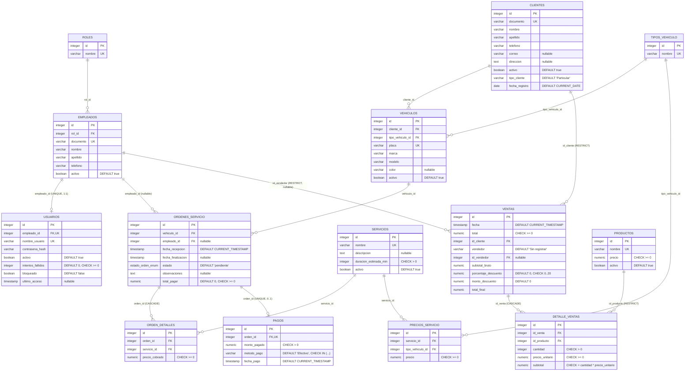

# DB-Diagram.md — Esquema real de `Pepokita`

Generado desde la base de datos activa PostgreSQL (`localhost:5432`, base `Pepokita`, esquema `public`) el 2026-11-25.
Incluye las 14 tablas reales, 1 tipo ENUM, llaves primarias/foráneas, restricciones `UNIQUE`/`CHECK` e índices.
El script IDempotente correspondiente es `DB-scrip.sql`.

## 1. Diagrama Mermaid (`erDiagram`)



## 2. Diagrama visual ASCII (campos clave, cardinalidades y FKs)

```text
LEYENDA:  (1)  uno  |  (0..1) opcional  |  (N) muchos  |  <--- FK (muchos apuntan a uno)

  ┌───────────────────────────┐             ┌────────────────────────────┐
  │ ROLES (1)                 │             │ TIPOS_VEHICULO (1)         │
  │ id PK · nombre UK         │             │ id PK · nombre UK          │
  └─────────────┬─────────────┘             └──────┬──────────┬──────────┘
                │ 1:N  empleados.rol_id            │ 1:N      │ 1:N
                v                                  v          v
  ┌───────────────────────────┐   ┌────────────────────────┐  ┌──────────────────────────┐
  │ EMPLEADOS (1)             │   │ VEHICULOS (N)          │  │ PRECIOS_SERVICIO (N)     │
  │ id PK · documento UK      │   │ id PK · placa UK       │  │ id PK                    │
  │ rol_id FK -> roles        │   │ cliente_id FK          │  │ servicio_id FK --------+ │
  └──┬────────┬────────┬──────┘   │ tipo_vehiculo_id FK    │  │ tipo_vehiculo_id FK ---+ │
     │ 1:1    │ 1:N    │ 1:N      └───────────┬────────────┘  │ UK(servicio,tipo)      | │
     v        v        v                      │ 1:N           └────────────────────────|─┘
  ┌──────────────┐ ┌─────────────────────┐    v                     (servicios)      |
  │ USUARIOS     │ │ ORDENES_SERVICIO    │ ┌──────────────────────────────┐             |
  │ id PK        │ │ id PK               │ │ ORDENES_SERVICIO (1)         │             |
  │ empleado_id  │ │ vehiculo_id FK      │ │ estado ENUM · fecha_recepcion│             |
  │  FK+UK       │ │ empleado_id FK (?)  │ └──────────────┬───────────────┘             |
  │ nombre_usuario UK             │      │ 1:N                  │ 0..1                  |
  └──────────────┘ └──────────┬──────────┘                      v                       v
                             │ 1:N        ┌──────────────────────────┐  ┌──────────────────────┐
                             v            │ ORDEN_DETALLES (N)       │  │ PAGOS (0..1)         │
                    ┌─────────────────┐   │ id PK · orden_id FK      │  │ id PK                │
                    │ VENTAS (N)      │   │ servicio_id FK --------+ │  │ orden_id FK+UK       │
                    │ id PK           │   │ precio_cobrado >= 0      │  │ monto_pagado > 0     │
                    │ id_cliente FK   │   └──────────────────────────|──┘ └──────────────────────┘
                    │ id_vendedor FK (?)                  (servicios) |
                    │ subtotal_bruto · % · desc · total_final         |
                    └──────────┬───────────────────────────────────────┘
                               │ 1:N (ON DELETE CASCADE)
                               v
                    ┌──────────────────────────┐        ┌──────────────────────────────┐
                    │ DETALLE_VENTAS (N)       │        │ CLIENTES (1)                 │
                    │ id PK · id_venta FK      │        │ id PK · documento UK         │
                    │ id_producto FK --------+ │        │ activo · tipo_cliente        │
                    │ cantidad > 0 · precio    │        │ fecha_registro               │
                    │ subtotal = cant*precio   │        └──────────────┬───────────────┘
                    └──────────────────────────|──┐                    │ 1:N (ventas, vehiculos)
                                       (productos)  |                 v
  ┌──────────────────────────────┐              └──────────────────────────────┐
  │ SERVICIOS (1)                │                 │ ( Clientes / Ventas )      │
  │ id PK · nombre UK            │<---------------- │ ver relaciones marcadas    │
  │ duracion_estimada_min > 0    │   orden_detalles │                            │
  └──────────────────────────────┘   precios_servicio └──────────────────────────────┘

  ┌──────────────────────────────┐
  │ PRODUCTOS (1)                │<---- detalle_ventas.id_producto (ON DELETE RESTRICT)
  │ id PK · nombre UK            │
  │ precio >= 0 · activo         │
  └──────────────────────────────┘
```

### Relaciones (FK) en texto

| Hijo (N) | Columna FK | Padre (1) | On delete | Cardinalidad |
| --- | --- | --- | --- | --- |
| `empleados` | `rol_id` | `roles.id` | NO ACTION | 1:N |
| `usuarios` | `empleado_id` (UNIQUE) | `empleados.id` | NO ACTION | 1:1 |
| `vehiculos` | `cliente_id` | `clientes.id` | NO ACTION | 1:N |
| `vehiculos` | `tipo_vehiculo_id` | `tipos_vehiculo.id` | NO ACTION | 1:N |
| `ordenes_servicio` | `vehiculo_id` | `vehiculos.id` | NO ACTION | 1:N |
| `ordenes_servicio` | `empleado_id` (nullable) | `empleados.id` | NO ACTION | 0..1:N |
| `orden_detalles` | `orden_id` | `ordenes_servicio.id` | CASCADE | 1:N |
| `orden_detalles` | `servicio_id` | `servicios.id` | NO ACTION | 1:N |
| `pagos` | `orden_id` (UNIQUE) | `ordenes_servicio.id` | NO ACTION | 1:0..1 |
| `precios_servicio` | `servicio_id` | `servicios.id` | NO ACTION | 1:N |
| `precios_servicio` | `tipo_vehiculo_id` | `tipos_vehiculo.id` | NO ACTION | 1:N |
| `ventas` | `id_cliente` | `clientes.id` | RESTRICT | 1:N |
| `ventas` | `id_vendedor` (nullable) | `empleados.id` | RESTRICT | 0..1:N |
| `detalle_ventas` | `id_venta` | `ventas.id` | CASCADE | 1:N |
| `detalle_ventas` | `id_producto` | `productos.id` | RESTRICT | 1:N |

## 3. Inventario de índices (además de PK/UNIQUE automáticos)

| Tabla | Índice | Columnas |
| --- | --- | --- |
| `clientes` | `clientes_documento_key` | `documento` (UNIQUE) |
| `detalle_ventas` | `idx_detalle_ventas_venta` / `idx_detalle_ventas_producto` | `id_venta` / `id_producto` |
| `empleados` | `empleados_documento_key`, `idx_empleados_rol` | `documento` (UNIQUE), `rol_id` |
| `orden_detalles` | `idx_detalles_orden`, `idx_orden_detalles_servicio` | `orden_id`, `servicio_id` |
| `ordenes_servicio` | `idx_ordenes_vehiculo`, `idx_ordenes_empleado`, `idx_ordenes_estado` | `vehiculo_id`, `empleado_id`, `estado` |
| `pagos` | `pagos_orden_id_key` | `orden_id` (UNIQUE) |
| `precios_servicio` | `precios_servicio_servicio_id_tipo_vehiculo_id_key`, `idx_precios_servicio_servicio`, `idx_precios_servicio_tipo` | `(servicio_id, tipo_vehiculo_id)` (UNIQUE), `servicio_id`, `tipo_vehiculo_id` |
| `productos` | `productos_nombre_key` | `nombre` (UNIQUE) |
| `roles` | `roles_nombre_key` | `nombre` (UNIQUE) |
| `servicios` | `servicios_nombre_key` | `nombre` (UNIQUE) |
| `tipos_vehiculo` | `tipos_vehiculo_nombre_key` | `nombre` (UNIQUE) |
| `usuarios` | `usuarios_nombre_usuario_key`, `usuarios_empleado_id_key` | `nombre_usuario`, `empleado_id` (UNIQUE) |
| `vehiculos` | `vehiculos_placa_key`, `idx_vehiculos_cliente` | `placa` (UNIQUE), `cliente_id` |
| `ventas` | `idx_ventas_fecha` (DESC), `idx_ventas_cliente`, `idx_ventas_vendedor`, `idx_ventas_id_vendedor` | `fecha`, `id_cliente`, `vendedor`, `id_vendedor` |

## 4. Notas

- `ordenes_servicio.estado` usa el ENUM `public.estado_orden_enum`: `pendiente`, `en_proceso`, `listo`, `entregado`, `cancelado`.
- CR-01 en `ventas`: `ck_ventas_descuento_rango` (0..20), `ck_ventas_montos_coherentes` (subtotal/descuento/total final/total) y `ck_ventas_vendedor` (vendedor no vacío; con descuento requiere vendedor real).
- No hay tabla de logs/errores en la BD; `errores_sistema.log` es archivo plano (ver `AGENTS.md`).
- El diagrama refleja la BD real, incluidas tablas de órdenes/pagos aún sin controladores en la app.
